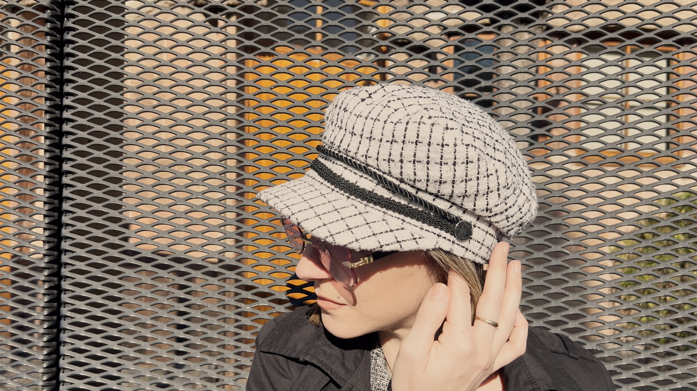
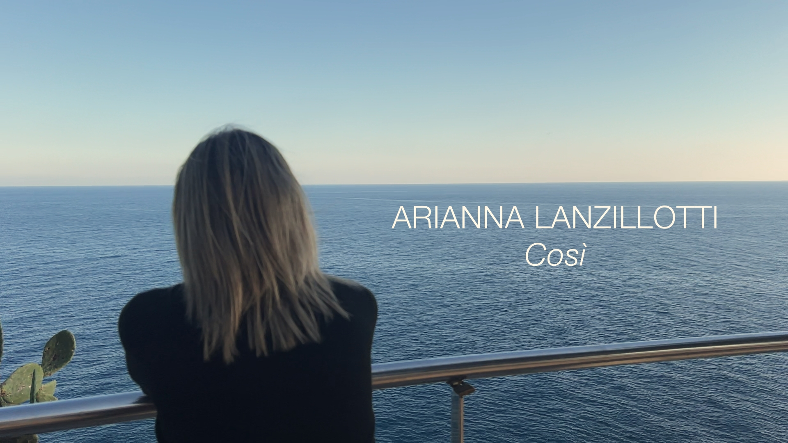

A few months ago I wrote about [vibe coding my wife's website](/blog/vibe-coding-my-wifes-website). The site went live, Arianna kept releasing music, and one of her songs, *Così*, still had no video. We had the footage: a performance by the sea in Tossa de Mar, and clips of Arianna walking through Barcelona that nobody had touched for months.

So I asked myself the same question as last time, one level harder. AI helped me build a website for a non-technical client. Could it help an engineer who had never edited a video make an official music video that a pop artist is happy to put her name on?

Here is how it went, from a folder of raw 4K files to a YouTube Premiere on **Friday 4 December at 19:00**.

## The Brief

Three lines, and each one was a constraint:

- **Romantic, not sexy.** *Così* is a love song. The video had to feel like a walk with someone you love, not like an ad. That ruled out a few shots that would probably get more likes. I could live with that.
- **No extra shoots.** We had already lost a lot of time. Everything had to come from the footage we had, flaws included.
- **Free tools.** DaVinci Resolve, free version, on my Mac. I thought about paying for CapCut, but first I wanted to see how far Resolve could take me. It took me all the way.

The idea was simple: alternate the performance by the sea with Arianna walking through Barcelona, from the Sagrada Família to the Barri Gòtic, and let the city tell the story of the song.

## Why Not an AI Video Tool

I did not use an AI video tool, and that was a choice. I wanted full control of the creative process, down to the smallest detail, so that the final video would feel mine. A generated video might have been faster. It would not have been ours.

## Claude as Co-Editor

Instead, Claude was my co-editor, and Resolve was the instrument.

Claude could read the project folder on my Mac: the master audio, the lyrics, about fifty raw clips. It catalogued the clips, made contact sheets from small previews, wrote an edit plan linked to the lyrics, and then guided me through Resolve one click at a time. I sent screenshots, it told me where to look. When I got lost, it explained the concept first and the button second.

Two habits made this work over many evenings. Neither is new to any engineering team:

- **A tasklist.** I asked for it on day one, so I would not lose the thread between sessions. Eight phases, from setup to launch. It is the most boring part of the project, and the first thing I would keep.
- **Short feedback loops.** After each milestone I exported a small, low-resolution version, five in total, and Claude reviewed it like a demanding friend: a jump cut here, a black gap there, ten seconds of silence under the credits.

Not everything worked. Claude's first idea to organise the clips, an automated workflow, did not work for me. I said so, we dropped it, and I placed the clips by hand. The plan can change. The tasklist tells you where you really are.

## The Edit, or: The Fly

I could write about markers, cuts and colour. It would be accurate, and you would stop reading. So let me tell you about the fly.

It crossed the frame for eight frames, right in front of Arianna. A third of a second. Most people would never notice it. I did, and once you see it, you cannot unsee it.

There was no button for this. I opened Fusion, the visual effects part of Resolve, picked a clone tool, and painted the background over the fly. Frame by frame. Eight frames, eight small paintings.

Ten minutes of my life I am strangely proud of.

It is also the best example of why I did not want an AI video tool. A generated video would never have had the fly. It would also never have had me in it, deciding that a third of a second mattered.

## The Launch Plan

I thought the edit was the end. It was the halfway point. Every engineer knows this feeling: code complete is not shipped.

The good news: the launch was already in the tasklist. On day one, Claude had planned it as the last phase, so when the edit was done I did not have to think about what came next. I just opened the list.

The whole launch took one evening, about 3 to 4 hours:

- **Three vertical teasers.** Claude helped me cut them from the final video.
- **The website.** Claude updated her site with a block that embeds the Premiere.
- **The YouTube channel.** Claude prepared the channel for the Premiere, with the help of a small YouTube CLI tool I built for myself. It is still a work in progress, and maybe the topic of a future post.

The AI did not make the launch creative. It made it fast, because nothing in it was a surprise.

## How Long It Took

Shooting took two afternoons. Everything else fitted in five days: a weekend plus three evenings after work.

- **Saturday:** catalogue, edit plan, tasklist, setup. About 5 hours.
- **Sunday:** the first full cut. About 6 hours.
- **Two evenings:** colour, the fly, credits, reviews, final export. About 6 to 8 hours.
- **One evening:** the launch. About 3 to 4 hours.

In total, about 20 to 23 hours, from the first look at the raw files to a scheduled Premiere.

Could I have done it faster with more AI? Probably. But I wanted to have fun :)

## What It Taught Me About AI as a Creative Partner

On the website, the AI did the implementation and I did the judgment. On the video, the split moved. Claude planned, taught and reviewed. My hands did the work, in a tool I had never opened. And the judgment stayed with the people who know what the song means.

That is also how I think about AI with my teams: it can plan, teach and review at a level that is hard to match. But someone still has to own the result.

I did not become a video editor. I became an engineer who can ship a music video. For my wife, that is more useful.

***The Premiere is on Friday 4 December at 19:00 CET. If you read this far, come and watch it.**

Arianna's music, and the video, are on [ariannalanzillotti.com](https://ariannalanzillotti.com).
